# IEIA — Database Schema

PostgreSQL 16 · normalized to 3NF for transactional tables · `jsonb` used only for
genuinely open-ended attributes and pre-computed explainability payloads.

The canonical DDL is `database/migrations/V1__init_schema.sql`.
Reference data (activity types, emission factors, scoring config, benchmarks) is
`V2__seed_reference_data.sql`. Demo user data is `database/seed/demo_data.sql`.

---

## 1. Design principles

1. **Three clearly separated tiers of data** (a hard requirement from the brief):
   - *Raw activity data* — `environmental_records`. Exactly what the user typed.
   - *Calculated emissions* — `calculated_impacts`. One row per (record, impact
     dimension). Never edited by users; fully derivable.
   - *Aggregated metrics* — `monthly_metrics`, `environmental_scores`. Rollups
     per (user, month). Also fully derivable, stored for query speed and history.

2. **Factors are data, not code.** `emission_factors` is a versioned,
   region-aware, time-effective table. The calculation engine resolves the right
   row at calculation time and snapshots the value it used onto the impact row,
   so historical numbers never silently change when a factor is updated.

3. **Everything is monthly.** A *period* is stored as a `DATE` pinned to the
   first day of the month (`period_month`). This matches utility billing and
   keeps time-series ML honest.

4. **UUID primary keys** (`gen_random_uuid()`), so ids are safe to expose in URLs
   and to generate client-side for optimistic UI.

5. **Enumerations as `VARCHAR` + `CHECK`**, not native `ENUM` types — easier to
   evolve and maps cleanly to JPA `@Enumerated(EnumType.STRING)`.

6. **`created_at` / `updated_at TIMESTAMPTZ`** on every table, `updated_at`
   maintained by the `set_updated_at()` trigger.

7. **Numeric types**: quantities and impacts `NUMERIC(16,4)`; scores and
   percentages `NUMERIC(6,2)`; money-like precision is never needed.

---

## 2. Entity–relationship diagram

```mermaid
erDiagram
    organizations ||--o{ users : "employs"
    users ||--o{ refresh_tokens : "has"
    users ||--o{ environmental_records : "logs"
    organizations ||--o{ environmental_records : "rolls up"
    activity_types ||--o{ environmental_records : "classifies"
    activity_types ||--o{ emission_factors : "converted by"
    activity_types ||--o{ anomalies : "about"
    environmental_records ||--o{ calculated_impacts : "produces"
    emission_factors ||--o{ calculated_impacts : "used for"
    users ||--o{ calculated_impacts : "owns (denorm)"
    users ||--o{ monthly_metrics : "aggregated for"
    users ||--o{ environmental_scores : "scored"
    scoring_configs ||--o{ environmental_scores : "computed with"
    users ||--o{ predictions : "forecast for"
    model_runs ||--o{ predictions : "produced by"
    users ||--o{ anomalies : "flagged for"
    environmental_records ||--o{ anomalies : "may reference"
    users ||--o{ scenarios : "builds"
    users ||--o{ recommendations : "receives"
    users ||--o{ reports : "generates"
    organizations ||--o{ reports : "scope"
    users ||--o{ ai_conversations : "starts"
    ai_conversations ||--o{ ai_messages : "contains"
    benchmarks ||..o{ environmental_scores : "compared against (logical)"

    organizations {
        uuid id PK
        varchar name
        varchar industry
        varchar country
        varchar region
        varchar size_category
        int headcount
        timestamptz created_at
        timestamptz updated_at
    }
    users {
        uuid id PK
        varchar email UK
        varchar password_hash
        varchar full_name
        varchar role
        uuid organization_id FK
        boolean is_active
        timestamptz last_login_at
        timestamptz created_at
        timestamptz updated_at
    }
    refresh_tokens {
        uuid id PK
        uuid user_id FK
        varchar token_hash UK
        timestamptz expires_at
        boolean revoked
        varchar user_agent
        varchar ip_address
        timestamptz created_at
    }
    activity_types {
        uuid id PK
        varchar code UK
        varchar category
        varchar name
        text description
        varchar default_unit
        jsonb allowed_units
        jsonb attribute_schema
        boolean is_active
        timestamptz created_at
        timestamptz updated_at
    }
    emission_factors {
        uuid id PK
        uuid activity_type_id FK
        varchar impact_type
        varchar unit_from
        varchar unit_to
        numeric value
        varchar region
        varchar source
        date effective_from
        date effective_to
        boolean is_active
        timestamptz created_at
        timestamptz updated_at
    }
    environmental_records {
        uuid id PK
        uuid user_id FK
        uuid organization_id FK
        uuid activity_type_id FK
        date period_month
        numeric amount
        varchar unit
        varchar location
        varchar source_detail
        jsonb attributes
        text note
        uuid created_by FK
        timestamptz created_at
        timestamptz updated_at
    }
    calculated_impacts {
        uuid id PK
        uuid environmental_record_id FK
        uuid user_id FK
        date period_month
        varchar impact_type
        numeric value
        varchar unit
        uuid emission_factor_id FK
        numeric factor_value
        varchar calculation_method
        timestamptz calculated_at
    }
    monthly_metrics {
        uuid id PK
        uuid user_id FK
        uuid organization_id FK
        date period_month
        numeric total_co2e_kg
        numeric total_energy_mj
        numeric total_water_litre
        numeric total_waste_kg
        numeric recycled_fraction
        jsonb co2e_by_category
        jsonb co2e_by_activity
        int record_count
        timestamptz computed_at
    }
    scoring_configs {
        uuid id PK
        varchar version UK
        boolean is_active
        jsonb weights
        jsonb baselines
        jsonb scale_params
        text description
        timestamptz created_at
        timestamptz updated_at
    }
    environmental_scores {
        uuid id PK
        uuid user_id FK
        uuid organization_id FK
        date period_month
        uuid scoring_config_id FK
        numeric overall_score
        numeric carbon_score
        numeric energy_score
        numeric water_score
        numeric waste_score
        numeric transport_score
        jsonb score_breakdown
        numeric previous_score
        numeric delta
        jsonb drivers
        timestamptz computed_at
    }
    model_runs {
        uuid id PK
        varchar model_type
        varchar target_metric
        varchar algorithm
        jsonb params
        jsonb metrics
        int training_rows
        int duration_ms
        timestamptz trained_at
    }
    predictions {
        uuid id PK
        uuid user_id FK
        uuid model_run_id FK
        varchar target_metric
        date generated_for_month
        date horizon_month
        numeric current_value
        numeric predicted_value
        numeric lower_bound
        numeric upper_bound
        numeric expected_change_abs
        numeric expected_change_pct
        varchar model_name
        jsonb feature_importance
        jsonb metrics
        text confidence_note
        timestamptz created_at
    }
    anomalies {
        uuid id PK
        uuid user_id FK
        uuid environmental_record_id FK
        uuid activity_type_id FK
        date period_month
        varchar metric
        varchar method
        numeric observed_value
        numeric baseline_value
        numeric deviation_abs
        numeric deviation_pct
        numeric score
        varchar severity
        varchar direction
        numeric estimated_co2e_impact_kg
        text explanation
        varchar status
        uuid reviewed_by FK
        timestamptz reviewed_at
        timestamptz detected_at
    }
    scenarios {
        uuid id PK
        uuid user_id FK
        varchar name
        text description
        date base_period_from
        date base_period_to
        jsonb baseline_snapshot
        jsonb adjustments
        jsonb result
        timestamptz created_at
        timestamptz updated_at
    }
    recommendations {
        uuid id PK
        uuid user_id FK
        date period_month
        int rank
        varchar category
        varchar title
        text rationale
        varchar action_type
        jsonb assumed_change
        numeric estimated_reduction_co2e_kg
        numeric estimated_reduction_pct
        jsonb estimated_other
        varchar confidence
        varchar basis
        varchar source
        varchar status
        timestamptz generated_at
    }
    reports {
        uuid id PK
        uuid user_id FK
        uuid organization_id FK
        varchar title
        date period_from
        date period_to
        varchar format
        varchar status
        jsonb payload
        varchar file_path
        bigint file_size_bytes
        timestamptz generated_at
        timestamptz created_at
    }
    ai_conversations {
        uuid id PK
        uuid user_id FK
        varchar title
        timestamptz created_at
        timestamptz updated_at
    }
    ai_messages {
        uuid id PK
        uuid conversation_id FK
        varchar role
        text content
        jsonb context_snapshot
        varchar model
        int tokens
        timestamptz created_at
    }
    audit_log {
        uuid id PK
        uuid user_id FK
        varchar action
        varchar entity_type
        uuid entity_id
        varchar ip_address
        varchar user_agent
        jsonb metadata
        timestamptz created_at
    }
```

---

## 3. Table-by-table notes

### `organizations`
Optional parent for users. An individual user has `organization_id = NULL`.
`size_category ∈ (INDIVIDUAL, SMALL, MEDIUM, LARGE)` drives which benchmark
segment applies. `headcount` is used to compute per-employee intensity for org
scoring and benchmarking.

### `users`
`role ∈ (ADMIN, ORG_OWNER, MEMBER, VIEWER)`.
- `ADMIN` — manages reference data (activity types, factors, benchmarks, scoring config).
- `ORG_OWNER` — sees org-wide aggregates for their `organization_id`.
- `MEMBER` — normal user; full CRUD on their own records.
- `VIEWER` — read-only (e.g. an auditor).
`email` is unique and citext-lowercased in the application layer.
`password_hash` is BCrypt. Never selected into DTOs.

### `refresh_tokens`
Opaque refresh tokens, **SHA-256 hashed** before storage (`token_hash UK`).
Rotated on every `/api/auth/refresh`: old row `revoked = true`, new row inserted.
`expires_at` enforced in queries and by a cleanup job. Enables real logout and
"log out everywhere".

### `activity_types` (reference data)
The catalogue of loggable activities. `category ∈ (ELECTRICITY, TRANSPORT, FUEL,
WATER, WASTE, MATERIALS)` — this is the **input** grouping.
- `default_unit`, `allowed_units` (`jsonb` string array) — the UI unit picker and
  server-side validation both read this.
- `attribute_schema` (`jsonb`) — declares extra fields the record's `attributes`
  must/should carry, e.g. for `TRANSPORT`: `{ "vehicle_type": {...}, "fuel_type":
  {...}, "num_trips": {...} }`. Lightweight, not a full JSON-Schema validator, but
  enough to render dynamic forms and do sanity checks.

### `emission_factors` (reference data — the extensibility core)
One activity type has **many** factors: different `impact_type`, `region`, and
time window.
- `impact_type ∈ (CO2E, ENERGY, WATER, WASTE)` — the **output** dimension.
- `unit_from` must be one of the activity type's `allowed_units`;
  `unit_to ∈ (kgCO2e, MJ, litre, kg)`.
- `value` is the multiplier: `impact = amount_in_unit_from × value`.
- `region` defaults to `'GLOBAL'`; a region-specific row (e.g. `'IN'`) overrides.
- `effective_from` / `effective_to` (nullable = "still current"). The resolver
  picks the row whose window contains the record's `period_month`, preferring the
  most specific region and latest `effective_from`.
- `source` is a human-readable citation (e.g. *"India CEA CO₂ Baseline Database
  v20.0 (2024)"*, *"UK DEFRA GHG Conversion Factors 2024"*, *"IPCC AR6 WG3"*).
- Unique: `(activity_type_id, impact_type, region, unit_from, effective_from)`.

### `environmental_records` (raw activity data)
Exactly what the user entered. `amount > 0` (CHECK), `unit` validated against the
activity type. `period_month` must be the first of a month and not in the future
(CHECK + app validation). `attributes jsonb` holds the category-specific extras
(vehicle/fuel type, disposal method, recycled fraction, usage category…).
`organization_id` is denormalized from the user at insert time for fast org
rollups. Indexed on `(user_id, period_month)`, `(user_id, activity_type_id,
period_month)`, `(organization_id, period_month)`.

### `calculated_impacts` (calculated emissions)
Derived, one row per `(record, impact_type)`. `UNIQUE (environmental_record_id,
impact_type)`. `ON DELETE CASCADE` from the record. Stores `emission_factor_id`
**and** a `factor_value` snapshot + `calculation_method` string so the number is
reproducible and auditable even after factor updates. `user_id` and
`period_month` are denormalized for aggregation queries. Indexed on `(user_id,
period_month, impact_type)`.

### `monthly_metrics` (aggregated metrics)
Upserted rollup per `(user_id, period_month)` — `UNIQUE` on that pair.
Totals per dimension plus `co2e_by_category` and `co2e_by_activity` (`jsonb`
maps) and `recycled_fraction` (weighted). `record_count` powers empty/low-data
states and ML gating. Recomputed transactionally after any record change in that
month.

### `scoring_configs` (configurable scoring)
Versioned methodology. Exactly one row has `is_active = true` (enforced by a
partial unique index). Holds:
- `weights` — `{carbon, energy, water, waste, transport}` summing to 1.
- `baselines` — reference "good" (`g`) and "poor" (`p`) monthly values per metric,
  per scope (`INDIVIDUAL` / per-employee `ORGANIZATION`) and region.
- `scale_params` — clamping, recycling bonus size, rounding rules.
See `06-scoring-methodology.md` for the exact math.

### `environmental_scores` (aggregated metric — the score)
Upserted per `(user_id, period_month)`. Overall + five category sub-scores.
`score_breakdown jsonb` stores every intermediate value (raw metric, baseline
used, normalized sub-score, weight, weighted contribution) so the UI can show a
fully transparent derivation. `previous_score`, `delta`, and `drivers jsonb`
(`[{category, metric, change_pct, points_impact, direction}]`) support the
"your score changed by X because…" explainer. `scoring_config_id` records which
methodology version produced it.

### `model_runs`
One row per ML training execution (`model_type ∈ (PREDICTION, ANOMALY)`).
`algorithm`, `params jsonb`, `metrics jsonb` (`{mae, rmse, r2, cv_folds, …}`),
`training_rows`, `duration_ms`. Gives the report reproducible, cite-able results
and lets the UI show "model last trained / evaluated" honestly.

### `predictions`
One row per `(user_id, target_metric, horizon_month)` generation.
`target_metric ∈ (CO2E, ENERGY, WATER, SCORE)`. Stores `current_value`
(last actual), `predicted_value`, `[lower_bound, upper_bound]` interval,
`expected_change_abs/pct`, `model_name`, `feature_importance jsonb`,
`metrics jsonb`, and a plain-language `confidence_note`. Linked to a `model_run`.

### `anomalies`
`metric ∈ (ELECTRICITY, WATER, FUEL, WASTE, CO2E, ENERGY, TRANSPORT)`.
`method ∈ (ZSCORE, IQR, STL_RESIDUAL, ISOLATION_FOREST, CONSENSUS)`.
`direction ∈ (SPIKE, DROP)`, `severity ∈ (LOW, MEDIUM, HIGH)`.
`observed_value` vs `baseline_value` with `deviation_abs/pct` and an anomaly
`score`. `estimated_co2e_impact_kg` = deviation in activity × current factor.
`status ∈ (OPEN, ACKNOWLEDGED, RESOLVED, DISMISSED)` with `reviewed_by` /
`reviewed_at` for the investigate workflow. May reference the specific
`environmental_record` that triggered it.

### `scenarios` (what-if)
User-named. `base_period_from/to` define the actual data window used as the
baseline; `baseline_snapshot jsonb` freezes the baseline metrics so the scenario
stays meaningful even if underlying data later changes. `adjustments jsonb` is an
array of typed levers (`PCT_REDUCTION`, `PCT_INCREASE`, `MODAL_SHIFT`,
`ABSOLUTE`, `RECYCLING_RATE`) scoped to a category or activity type. `result
jsonb` holds the recomputed metrics, deltas, per-category breakdown, and new
score. Multiple scenarios per user are compared in the UI.

### `recommendations`
Ranked (`rank`) per `(user_id, period_month)`. `basis ∈ (DATA_DRIVEN, GENERIC)`
makes explicit whether the recommendation came from the user's own dominant
contributors or a fallback. `source ∈ (RULE_ENGINE, LLM_ASSISTED)`.
`assumed_change jsonb` + `estimated_reduction_co2e_kg` + `estimated_other jsonb`
quantify the expected effect using the same factor math as the engine.
`status` tracks user follow-through.

### `reports`
`format ∈ (JSON, PDF)`, `status ∈ (PENDING, GENERATING, READY, FAILED)`.
`payload jsonb` is the full structured report (period, scores, metrics,
contributors, trends, anomalies, predictions, recommendations, scenarios).
`file_path` points to the rendered PDF on a mounted volume; `file_size_bytes`
for the download UI.

### `ai_conversations` / `ai_messages`
Chat history. `ai_messages.role ∈ (USER, ASSISTANT, SYSTEM)`.
`context_snapshot jsonb` on assistant messages stores the exact analytics bundle
sent to the LLM — essential for debugging "why did it say that" and for the
report's AI section. `model` and `tokens` for cost/observability.

### `audit_log`
Append-only. Auth events, reference-data changes, report generation, anomaly
review actions. Not on the hot path; written asynchronously.

---

## 4. Key relationships in words

- **User ↔ Organization**: many-to-one, optional. Deleting an organization is
  blocked while users reference it (`ON DELETE RESTRICT`); reassign first.
- **Record → Impacts**: one-to-many, `ON DELETE CASCADE`. Impacts never exist
  without their record.
- **ActivityType → EmissionFactors**: one-to-many. `ON DELETE RESTRICT` — you
  cannot delete an activity type that factors or records depend on; deactivate it
  (`is_active = false`) instead.
- **Record → EmissionFactor** (via impact): the factor actually used is pinned on
  `calculated_impacts.emission_factor_id` (`ON DELETE SET NULL` — keep the
  snapshot `factor_value` even if a factor row is later purged).
- **User → MonthlyMetric / EnvironmentalScore**: one-to-many, one per month
  (`UNIQUE (user_id, period_month)`). `ON DELETE CASCADE` with the user.
- **ScoringConfig → EnvironmentalScore**: one-to-many; a score records which
  config version produced it (`ON DELETE RESTRICT`).
- **ModelRun → Prediction**: one-to-many; `ON DELETE SET NULL` (predictions
  survive run cleanup, keeping their metrics snapshot).
- **Conversation → Messages**: one-to-many, `ON DELETE CASCADE`.
- **Benchmarks** relate to scores only *logically* (by `segment` + `metric`),
  not by FK, because a benchmark is a lookup, not an owned child.

---

## 5. Indexing summary

| Table | Index | Why |
|---|---|---|
| `users` | `UNIQUE(email)` | Login lookup |
| `refresh_tokens` | `UNIQUE(token_hash)`, `(user_id)`, `(expires_at)` | Refresh + cleanup |
| `activity_types` | `UNIQUE(code)`, `(category)` | Catalogue queries |
| `emission_factors` | `UNIQUE(activity_type_id, impact_type, region, unit_from, effective_from)`, `(activity_type_id, impact_type, region, effective_from DESC)` | Factor resolution |
| `environmental_records` | `(user_id, period_month)`, `(user_id, activity_type_id, period_month)`, `(organization_id, period_month)` | Dashboard, trends, org rollups |
| `calculated_impacts` | `UNIQUE(environmental_record_id, impact_type)`, `(user_id, period_month, impact_type)` | Aggregation |
| `monthly_metrics` | `UNIQUE(user_id, period_month)`, `(organization_id, period_month)` | Rollup upsert + org views |
| `environmental_scores` | `UNIQUE(user_id, period_month)` | Score history |
| `predictions` | `(user_id, target_metric, horizon_month DESC)` | Latest forecast |
| `anomalies` | `(user_id, period_month)`, `(user_id, status)` | Dashboard alerts, worklist |
| `scenarios` | `(user_id, created_at DESC)` | Scenario list |
| `recommendations` | `(user_id, period_month, rank)` | Ranked list |
| `reports` | `(user_id, created_at DESC)` | Report history |
| `ai_messages` | `(conversation_id, created_at)` | Chat render |
| `audit_log` | `(user_id, created_at DESC)`, `(entity_type, entity_id)` | Audit queries |

---

## 6. Triggers & helpers

- `set_updated_at()` — `BEFORE UPDATE` trigger on every table with `updated_at`.
- `enforce_first_of_month()` — `BEFORE INSERT/UPDATE` on `environmental_records`,
  `monthly_metrics`, `environmental_scores`: raises unless `period_month =
  date_trunc('month', period_month)`.
- Partial unique index `scoring_configs (is_active) WHERE is_active` — guarantees
  a single active methodology.
- Partial unique index `benchmarks (scope, segment, metric, period, region)
  WHERE is_active` — one active benchmark per slice.
